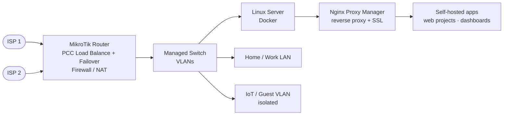

<h1 align="center">Hi 👋, I'm Jerome Jay Olavere</h1>
<h3 align="center">Web Developer · Network Engineer · Cybersecurity Analyst — Quezon City, Philippines 🇵🇭</h3>

  

  
  
  
  
  

---

## 🧑‍💻 About Me

- 🌐 **Web Developer** — I build business systems (HRIS, reservation and tracking systems) with PHP, CodeIgniter and MySQL
- 🛜 **Network Engineer** — MikroTik RouterOS v6/v7: multi-WAN PCC load balancing, policy-based routing, Netwatch failover, VLANs
- 🛡️ **Cybersecurity Analyst** — firewall design, network hardening, log monitoring and securing self-hosted services
- 🧪 **Home-lab tinkerer** — I test configs in my own lab before they go anywhere near production
- 🦀 Currently learning **Rust** to build networking tools
- 💬 Ask me about **Network Firewalls · MikroTik · Web App Development · Self-hosting**

---

## 🧪 My Home-Lab

> My home-lab is where I practice network engineering and security hands-on: routing, firewalling, self-hosting and monitoring.

| Area | What I run / practice |
|------|-----------------------|
| 🛜 **Routing** | MikroTik RouterOS v7 · dual-WAN PCC load balancing · policy-based routing (pin devices/games to a WAN) · Netwatch failover |
| 🔥 **Security** | Stateful firewall rules · port-scan & brute-force protection · VLAN isolation for IoT and guests · VPN (WireGuard) for remote access |
| 🐳 **Self-hosting** | Docker + Portainer stacks on Linux · Nginx Proxy Manager (NPMplus) with Let's Encrypt SSL · macvlan LAN networking · PostgreSQL · hosting my own web projects |
| 📊 **Monitoring** | Bandwidth and uptime monitoring · router logs · alerts when a WAN goes down |
| ⚙️ **Automation** | RouterOS scripting · Bash/Python helper scripts · [`mikrogen7-server`](https://github.com/JeromeJayOlavere/mikrogen7-server) (Rust) |

---

## 🚀 Featured Projects

| Project | Description | Stack |
|---------|-------------|-------|
| [**mikrogen7-server**](https://github.com/JeromeJayOlavere/mikrogen7-server) | Self-hosted backend for the RouterOS Forge desktop app: team accounts, synced generator configs, an end-to-end-encrypted router credential vault and a deploy audit log. Runs on Portainer behind Nginx Proxy Manager with Let's Encrypt |    |
| [**hris-system**](https://github.com/JeromeJayOlavere/hris-system) | HR Information System with admin/user dashboards and performance modules (IPCR, OPCR, SPMS) plus OJT records |   |
| [**MarlferPortfolio**](https://github.com/JeromeJayOlavere/MarlferPortfolio) | Responsive portfolio site, shipped as a hardened Nginx container (non-root, read-only filesystem, health checks) with Docker CI |    |

---

## 🛠️ Skills & Tools

**Web Development**

  

**Networking & Security**

  
  
  
  
  
  
  

**Infrastructure & Tools**

  

---

## 📊 GitHub Stats

  
  

  

---

<i>“Secure the network, ship the app.”</i> 🛡️💻

